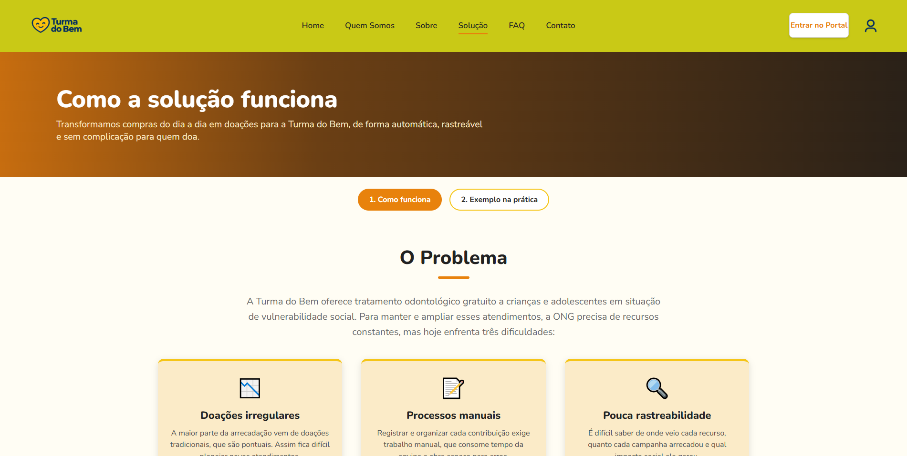
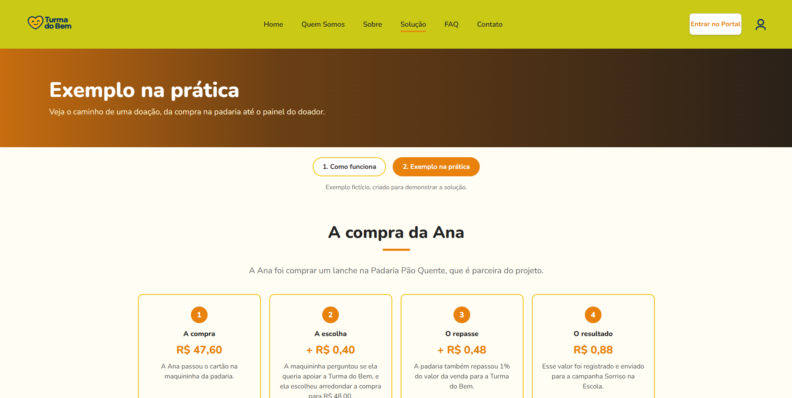
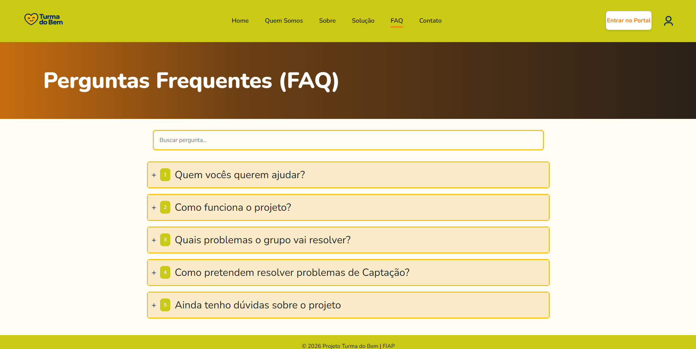
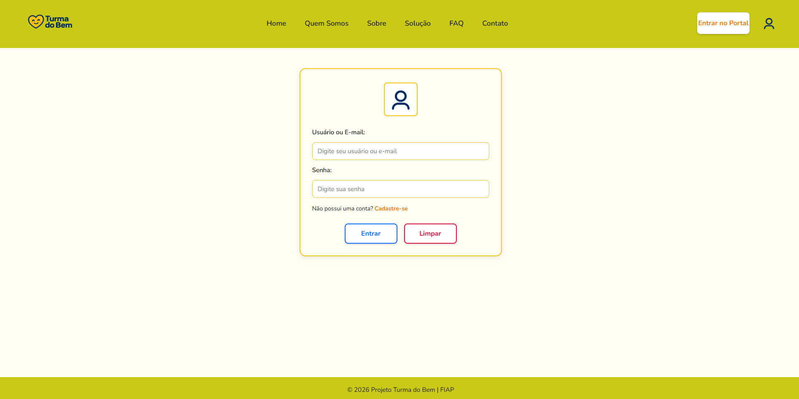
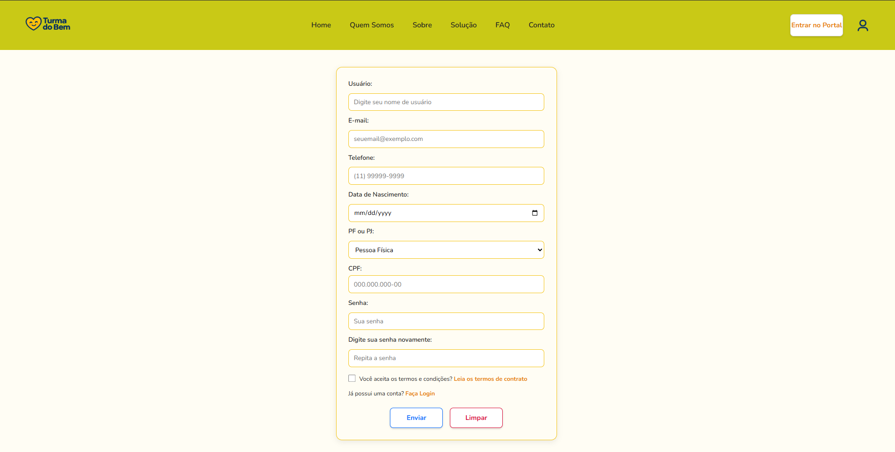

# 💙 Portal Turma do Bem

> Projeto desenvolvido para a Sprint 02 da disciplina de **Front-End Design Engineering**.

---

## 📌 Sumário

1. [Título e Descrição](#-1-título-e-descrição)
2. [Problema Abordado e Solução](#-2-problema-abordado-e-solução)
3. [Tecnologias Utilizadas](#-3-tecnologias-utilizadas)
4. [Estrutura de Pastas do Projeto](#-4-estrutura-de-pastas-do-projeto)
5. [Autores e Créditos](#-5-autores-e-créditos)
6. [Imagens e Ícones Relacionados ao Projeto](#-6-imagens-e-ícones-relacionados-ao-projeto)
7. [Link do Repositório do GitHub](#-7-link-do-repositório-do-github)
8. [Contato](#-8-contato)

---

## 📖 1. Título e Descrição

O **Portal Turma do Bem** é uma plataforma web voltada para promover o acesso à saúde bucal, conectando voluntários, beneficiários e apoiadores de causas sociais relacionadas à odontologia.

O sistema apresenta a proposta da organização, fornece informações transparentes, assegura navegação fluida entre seções desktop e disponibiliza canais de comunicação estruturados, agora contando com funcionalidades interativas.

---

## 💡 2. Problema Abordado e Solução

- **Problema:** A carência de acesso a tratamento odontológico adequado para populações em situação de vulnerabilidade social e jovens em busca de oportunidades.
- **Solução:** Uma interface web moderna e interativa que centraliza informações institucionais, propicia uma experiência imersiva e evidencia a atuação da rede de dentistas parceiros, utilizando tecnologias web atualizadas.

---

## 🚀 3. Tecnologias Utilizadas

De acordo com as diretrizes técnicas da Sprint 02:

- **HTML5 Semântico:** Estruturação lógica das páginas.
- **CSS3 Puro:** Estilização sem utilização de frameworks externos.
- **JavaScript:** Implementação de funcionalidades interativas e dinamismo nas páginas.
- **Git e GitHub:** Ferramentas de versionamento, controle de histórico e colaboração em equipe.

---

## 📁 4. Estrutura de Pastas do Projeto

A organização interna dos diretórios e arquivos do repositório segue a estrutura abaixo:

```text
Portal_Turma_do_Bem/
├── css/
│   ├── cadastro.css
│   ├── contato.css
│   ├── faq.css
│   ├── login.css
│   ├── QuemSomos.css
│   ├── sobre.css
│   ├── solucao.css
│   └── style.css
├── Img/
│   ├── contato.png
│   ├── css.png
│   ├── faq.png
│   ├── Gustavo.png
│   ├── home.png
│   ├── html.png
│   ├── icon.ico
│   ├── icon.png
│   ├── iconePerfil.png
│   ├── impacto.png
│   ├── java.png
│   ├── Jonatas.png
│   ├── logo.png
│   ├── Lucca.png
│   ├── Miguel.png
│   ├── problema.pnj.avif
│   ├── python.png
│   ├── quemsomos.png
│   ├── roadmap.png
│   ├── ryan.png
│   ├── sobre.png
│   ├── solucao.png
│   ├── sql.png
│   └── TDB.png
├── js/
│   └── comoFunciona.js
│   ├── faq.js
│   └── script.js
│   └── solucao.js
├── cadastro.html
├── comoFunciona.html
├── contato.html
├── faq.html
├── index.html
├── login.html
├── quemSomos.html
├── simulacao.html
├── sobre.html
└── README.md
```

---

## 👥 5. Autores e Créditos

<div align="center">

| Foto | Nome Completo | RM | Turma | Redes / Links |
| :---: | :--- | :---: | :---: | :--- |
|  | Gustavo Almeida | 576039 | 1TDSPR | [GitHub](https://github.com/goliveiraalmeida) / [LinkedIn](https://www.linkedin.com/in/goliveiraalmeida/) |
|  | Jonatas Ferreira | 576943 | 1TDSPR | [GitHub](https://github.com/jonatazf) / [LinkedIn](https://www.linkedin.com/in/jonatazf/) |
|  | Lucca Floriano | 575494 | 1TDSPR | [GitHub](https://github.com/luccafloriano-7) / [LinkedIn](https://github.com/luccafloriano-7) |
|  | Luiz Azevedo | 575245 | 1TDSPR | [GitHub](https://github.com/lazevedo2000-sudo) / [LinkedIn](https://github.com/lazevedo2000-sudo) |
|  | Ryan Prandi | 576358 | 1TDSPR | [GitHub](https://github.com/prandiryan) / [LinkedIn](https://www.linkedin.com/in/ryan-prandi) |

</div>

---

## 🎨 6. Imagens e Ícones Relacionados ao Projeto

### Identidade Visual

O projeto utiliza elementos gráficos armazenados na pasta `Img/`, traduzindo a identidade visual da Turma do Bem por meio de logotipos e ícones personalizados.

### Capturas de Tela da Interface

Página inicial do Portal Turma do Bem


Quem Somos


Sobre


Solução (Como Funciona)


Solução (Exemplo na prática)


Perguntas Frequentes (FAQ)


Contato


Login


Cadastro



---

## 🔗 7. Link do Repositório do GitHub

Acesse o código-fonte e o histórico de commits do projeto:

👉 [**Repositório no GitHub**](https://github.com/lazevedo2000-sudo/Portal_Turma_do_Bem)

---

## ✉️ 8. Contato

- **E-mail de suporte:** `contato@turmadobem.org.br`

---

